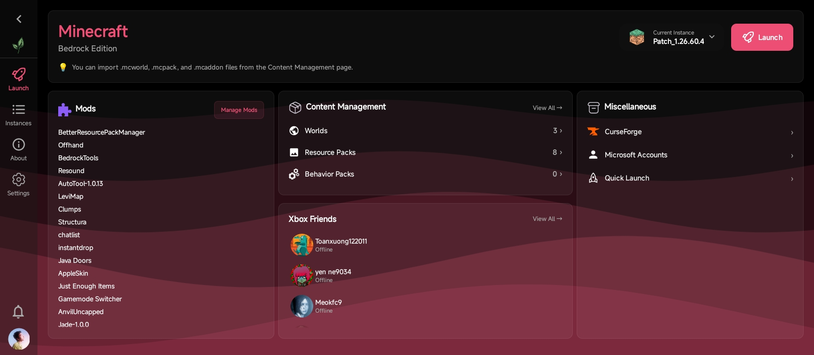

<div align="center">


# LeviLauncher for Android (Modder ver.)

🇺🇸 [English](README.md) | 🇻🇳 [Tiếng Việt (Vietnamese)](README_vi.md) | **🇯🇵 日本語 (Japanese)** | 🇷🇺 [Русский (Russian)](README_ru.md) | 🇨🇳 [中文 (Chinese)](README_zh.md)


**Minecraft: Bedrock Edition 用の軽量 Android ランチャー**

[](https://github.com/sang765/LeviDroid-Modder/releases)
[](https://github.com/sang765/LeviDroid-Modder/blob/main/LICENSE)
[](https://github.com/sang765/LeviDroid-Modder/issues)
[](https://github.com/sang765/LeviDroid-Modder)
[](https://github.com/sang765/LeviDroid-Modder/releases)
[](https://www.android.com/)

<table>
  <tr>
    <td><a href="docs/screenshots/01-splash.jpg"></a></td>
    <td><a href="docs/screenshots/02-dashboard.jpg"></a></td>
  </tr>
  <tr>
    <td><a href="docs/screenshots/03-instances.jpg"></a></td>
    <td><a href="docs/screenshots/04-about.jpg"></a></td>
  </tr>
  <tr>
    <td><a href="docs/screenshots/05-settings.jpg"></a></td>
    <td><a href="docs/screenshots/06-mods.jpg"></a></td>
  </tr>
  <tr>
    <td><a href="docs/screenshots/07-world-editor.jpg"></a></td>
    <td><a href="docs/screenshots/08-launch.jpg"></a></td>
  </tr>
</table>

https://github.com/user-attachments/assets/f69146c1-725c-46e7-9983-0768f6841910

**[ドキュメント](https://docs.levimc.org/LeviLauncher/guide/quick-start?platform=android)** · **[ネイティブ Mod 開発](https://docs.levimc.org/LeviLamina/developer_guides/android/)**

</div>

---

## はじめに

LeviLauncher Modder は、Minecraft: Bedrock Edition（MCBE）の正規プレイヤーのために設計された、軽量でオープンソースの Android ランチャーです。標準の Google Play からのインストールに対して、柔軟で使いやすい代替手段を提供し、複数のゲームバージョンの管理や、外部モジュールによる機能拡張が可能になります。

LeviLauncher Modder は、[LeviMC チーム](https://github.com/LiteLDev)によるオリジナルの [LeviLauncher](https://github.com/LiteLDev/LeviLauncher-Android) から独立して分岐したフォークで、このリポジトリでは [sang765](https://github.com/sang765) がメンテナンスしています。

LeviLauncher Modder を使うと、公式の Minecraft APK をインポートして、システムへのインストールなしに直接実行できます。ランチャーは外部ネイティブモジュールの読み込みに対応してゲームプレイを強化し、インストール間を完全に分離した堅牢なマルチバージョン管理を提供し、リソースパックやワールドを管理するためのツールを内蔵しています。異なるゲームバージョンの整理、改修のテスト、あるいはゲーム体験の最適化など、LeviLauncher Modder は必要な柔軟性を提供してくれます。

---

## 主な機能

### オリジナルアプリ

- **APK インストール不要のインポート＆起動** – 公式の Minecraft APK をインポートし、システムへのインストールなしに直接実行
- **SO モジュールの読み込み** – 外部のネイティブ SO モジュールを読み込み、Minecraft の機能やパフォーマンスを拡張・強化
- **マルチバージョン管理とバージョン分離** – 設定とデータを分離した状態で、複数の Minecraft バージョンを独立して管理
- **複数 Xbox アカウント管理** – ランチャー内で複数の Xbox アカウントを管理し、シームレスに切り替え
- **リソースパック＆ワールド管理** – 内蔵マネージャーでリソースパックやワールドのインポート・エクスポート・バックアップ
- **ワールドマップ＆高度な NBT 編集** – ワールドをライブマップで閲覧し、ワールドエディターで NBT データ（ワールド設定、チャンク、データベースレコード）を編集。段階的な保存と自動バックアップ付き — アップストリームのワールドツール更新より

### 私のフォーク

オリジナルの機能セットを**ほぼ**維持しつつ、このコミュニティ向けの変更を追加しています。[LiteLDev/LeviLauncher-Android](https://github.com/LiteLDev/LeviLauncher-Android) との比較:

- **Google Play ストア不要** – オリジナルは Minecraft が Google Play からインストールされていないと起動をブロックしていました。このフォークはデバイス上に正規の Minecraft Bedrock がインストールされていればよく、インポートされたインスタンス（上の APK インポートを参照）は Minecraft を完全にアンインストールした状態でも起動できます。ランチャーが独自の APK コピーからゲームを実行するためです。
- **パッチ適用済み Minecraft（MCPatch）対応** – パッチ適用版ビルドは、通常はインストール済みパッチ適用アプリの中でのみ解決されるネイティブライブラリを注入して同梱しています。ランチャーがそれらのライブラリを自身で読み込むため、パッチ適用アプリをデバイスにインストールせずに、パッチ適用済み APK を直接インポートして起動できます。
- **コピー可能なクラッシュログ** – ゲームクラッシュダイアログに、フルログをクリップボードへコピーするボタンを追加し、問題の報告を簡単に。
- **CurseForge を任意機能化** – CurseForge API キーなしでコンパイルされたビルドでは、CurseForge の閲覧が自動的に非表示になり、常に表示されたままリクエストで失敗することがなくなりました。
- **壁紙のアクセントカラー** – テーマカラー設定に「壁紙の色を使用」オプションを追加し、壁紙からアクセントカラーを選択します。Android 11 以下では、壁紙が読み取れない場合にストレージアクセスを要求します。
- **リブランディングした UI とクレジット** – アプリ名は「LeviLauncher Modder」となり、About 画面には [sang765](https://github.com/sang765) のクレジットカードを表示。
- **代替の更新方法** – オリジナル版と異なり、Modder ビルドは Shizuku や root 経由でもインストールできます。
- **外部 Mod カタログ** – Mods 画面から、検索・選択中の Minecraft バージョンとの互換性フィルタリング・ワンタップインストールに対応したコミュニティ Mod のカタログへアクセスできます。
- **GitHub からの Mod インポート＆更新** – 「Mod を追加」ダイアログは、リポジトリの最新リリースから `.so`/`.levipack` ファイルをインポートします（リポジトリ URL、`user/repo`、`user repo` に対応）。Mod が別の Minecraft バージョン向けの場合は警告し、取得元を記憶して、Mod リストで新しいバージョンをフラグ表示（「バージョン 1.0 ⬆ 1.1」）し、ワンタップでインストールできるようにします。
- **Xbox フレンド連携** – 起動タブに、アバター・オンライン時のグロー・プレゼンスを表示するフレンドカードを表示。フルフレンド画面は検索、追加/削除、送受信のフレンドリクエスト（キャンセル対応）、プロフィールリンクに対応し、起動時・アカウント切り替え時・操作完了時に自動更新されます。
- **新機能ダイアログ** – 更新後に、そのバージョン向けに生成されたリリースノート付きの「新機能」ダイアログを表示。
- **ダーク AMOLED テーマ** – テーマモード設定で、システム追従・ライト・OLED 画面向けのピュアブラック AMOLED モードから選択できます。
- **Minecraft スタイルのコンテンツメタデータ** – パックや Mod の名前・説明に含まれる Minecraft のセクション記号カラーコード（`§`）を、生のテキストではなく実際の色として表示。
- **Material You アプリアイコン** – Android 12 以降では、ランチャーのアイコンがシステムのテーマアイコンの色に追従します。
- **Discord Rich Presence** – 任意の Discord 連携（設定から OAuth2 ログイン 1 回で有効化）により、Discord プロフィール上で現在の状態を表示できます: いるランチャー画面、CurseForge の閲覧、Xbox フレンド、実行中の Minecraft セッションなど。

---

## システム要件

LeviLauncher Modder をインストールする前に、デバイスが以下の最低要件を満たしていることを確認してください:

- **動作環境:** Android 9.0（API 28）以上
- **デバイスアーキテクチャ:** ARM64（v8a）または ARM32（v7a）
- **RAM:** 利用可能な RAM 1 GB 以上（2 GB 以上を推奨）
- **ストレージ:** Minecraft とゲームデータ用に最低 2 GB の空き容量
- **ライセンス要件:** Google Play で購入した正規の Minecraft Bedrock Edition を所有している必要があります

> [!NOTE]  
> 最適なパフォーマンスと安定性のため、Android 9.0 以上、利用可能 RAM 3 GB 以上、空きストレージ 5 GB 以上を推奨します。

---

## インストール

### 前提条件

LeviLauncher Modder のインストールを進める前に、Minecraft Bedrock Edition の正規ライセンス版を所有していることを確認してください。デバイスに既にインストールされている場合（正規の入手経路であればどの経路でも）か、ランチャーにインポートできる `.apk`/`.apks` ファイルとして用意されている必要があります。

### インストール手順

1. [リリースページ](https://github.com/sang765/LeviDroid-Modder/releases) を開き、最新リリースをダウンロードします。各リリースには 3 つの APK が同梱されています: 多くの最新デバイス向けの `-arm64-v8a`、古い 32 ビットデバイス向けの `-armeabi-v7a`、どちらか判断がつかない場合は両方を同梱した `-universal`
2. デバイスの設定を開き、「セキュリティ」または「アプリ」へ移動します
3. 「出所不明のアプリ」または「出所不明のソースからのインストールを許可」を有効にして、APK のインストールを許可します
4. ファイルマネージャーでダウンロードした APK ファイルを見つけ、タップしてインストールします
5. インストール中のプロンプトで、必要な権限を許可します
6. インストールが完了したら、アプリ一覧から LeviLauncher Modder を開きます

> [!IMPORTANT]  
> LeviLauncher Modder は、アップストリームの LeviLauncher プロジェクトと同様に、正規のライセンス付き Minecraft Bedrock Edition を必要とします。このランチャーを海賊版や無許可のバージョンのゲームと一緒にお使いにならないでください。Minecraft のライセンスが有効で、Microsoft アカウントに正しくリンクされていることを確認してください。

---

## 開発環境のセットアップ

LeviLauncher Modder をソースからビルドしたい場合や開発に貢献したい場合は、以下の手順で開発環境をセットアップしてください:

### 前提条件

- システムに Git がインストールされていること
- Android Studio（最新版を推奨）
- Java Development Kit（JDK）21 以上
- API レベル 28 以上の Android SDK
- ネイティブコードをビルドする場合は Android NDK と CMake（Android Studio の SDK Manager からインストール）

### セットアップ手順

1. LeviLauncher Modder のリポジトリをクローンします:

   ```bash
   git clone https://github.com/sang765/LeviDroid-Modder.git
   ```

2. Android Studio でプロジェクトディレクトリを開きます

3. Android Studio が必要な依存関係とビルドツールをダウンロード・インストールするのを待ちます

4. Gradle の初回同期プロセスが完了するのを待ちます

5. Android デバイスを接続するか、エミュレーター（API 28 以上）を起動します

6. Android Studio の「Run」ボタンをクリックして、ビルドしてデバイスにデプロイします

7. ビルドが成功すると、アプリが自動的に起動します

> **ビルドのヒント:** 開発中のビルドを高速化するには、フルリビルドの代わりに `Build > Make Project` でインクリメンタルコンパイルを使用してください。

Gradle 設定でのプロジェクトルート名は `levilauncher` ですが、リポジトリ名は `LeviDroid-Modder` です。コマンドラインからビルドする場合:

```bash
./gradlew assembleDebug
```

Windows では `.\gradlew.bat assembleDebug` を実行します。ランチャーのフローをテストする前に、テストデバイスに公式 Minecraft アプリの正規版をインストールしておいてください。

---

## 翻訳 [](https://hosted.weblate.org/engage/levidroid-modder/)

[](https://hosted.weblate.org/engage/levidroid-modder/)

[Hosted Weblate](https://hosted.weblate.org/projects/levidroid-modder/) で LeviLauncher Modder の翻訳をあなたの言語へ手伝ってください。ソース言語は英語で、翻訳はロケールごと（`values-<lang>` リソース）にメンテナンスされ、次のリリースに同梱されます。

---

## コントリビューションガイドライン

私たちは LeviLauncher Modder を改善するためのコミュニティからの貢献を歓迎します。高品質なコードベースとスムーズなコラボレーションを維持するため、以下のガイドラインにご協力ください:

### コード品質

説得力のある変数名と一貫したフォーマットで、クリーンでモジュール化されたコードを書いてください。プロジェクトで確立された Kotlin と Java のスタイルガイドラインに従ってください。将来のメンテナンス担当者が読みやすく構造化されたコードであることを確認してください。

### コンミット構成

明確で説得力のあるメッセージを使った、小さく焦点の絞られたコミットを使用してください。各コミットは 1 つの機能かバグ修正に対応すべきです。例:「バージョン管理のメモリリークを修正」や「ARM32 アーキテクチャ対応を追加」など。

### ドキュメント

複雑なロジックにはコメントを追加し、リポジトリの関連ドキュメントを更新してください。新しい機能を追加した場合は、README と関連するドキュメントファイルを更新してください。

### パフォーマンス

低遅延とスムーズなパフォーマンスを維持するために、すべての追加内容を最適化してください。変更がラグやパフォーマンスの劣化を引き起こしていないことを確認するため、徹底的にテストしてください。

### テスト

互換性と安定性を確認するため、複数のデバイスと Android バージョンですべての変更をテストしてください。

### プルリクエスト

解決した問題や追加した機能を含めた、変更の詳細な説明とともに PR を提出してください。関連する issue を参照し、UI に影響する変更の場合はスクリーンショットや動画を添付してください。

### コミュニティ規範

敬意とインクルーシブな環境を維持するため、行動規範に従ってください。フィードバックは建設的にし、他の人の成果物を尊重し、すべてのコントリビューターとプロフェッショナルにコミュニケーションしてください。

**提出前に:** エラーを最小限にするため、フルビルドサイクルを実行し、少なくとも 1 台のデバイスでテストしてください。すべての貢献を迅速にレビューし、LeviLauncher Modder の向上に対する尽力に感謝します。

---

## 利用ガイドライン

LeviLauncher Modder は、Minecraft Bedrock Edition の正規プレイヤーのために設計されています。以下のガイドラインと利用条件を守ってください:

### 許可されている利用

- 個人のゲームプレイや新機能のテストのために LeviLauncher Modder を改変すること
- LeviLauncher Modder の機能を紹介する教育目的のコンテンツ（動画、チュートリアル、ブログ記事）を作成すること
- 学習目的でのフォークや派生プロジェクトの作成（Apache License 2.0 に従う場合）
- Apache License 2.0 の条件に従う限り、改変版を他者と共有すること

### 禁止されている利用

- 元の LeviLauncher プロジェクトとその作者にクレジット表示せずに、LeviLauncher Modder を自分のものだと主張すること
- Mojang や Microsoft のユーザー契約に違反するために LeviLauncher Modder を使用すること

> **免責事項:** LeviLauncher Modder の作者およびコントリビューターは、本ソフトウェアの使用に起因するバン、損害、その他の問題について責任を負いません。ご自身の責任で、Minecraft の利用規約に従ってご使用ください。

法的な詳細については、リポジトリの LICENSE と NOTICE ファイルをご覧ください。

---

## クレジット＆謝辞

LeviLauncher Modder は、多くの才能ある個人や組織からの貢献とサポートなしには実現できませんでした:

### 特別な感謝

- **[LeviMC 組織](https://github.com/LiteLDev)** – このフォークの基盤となった元の [LeviLauncher](https://github.com/LiteLDev/LeviLauncher-Android) プロジェクトの作成とメンテナンスに対して
- **Android コミュニティ** – このランチャーを可能にした優れたドキュメント、ライブラリ、ツールに対して
- **オープンソース コミュニティ** – このプロジェクトを支えるすべてのライブラリ、フレームワーク、ツールに対して
- **コントリビューター** – 時間と専門知識を費やして LeviLauncher を継続的に改善・メンテナンスしてきた[元プロジェクトのすべてのコントリビューター](https://github.com/LiteLDev/LeviLauncher-Android/graphs/contributors)に心から感謝します

---

## 連絡先＆サポート

**メンテナンサー:** [sang765](https://github.com/sang765)

**プロジェクトリポジトリ:** [https://github.com/sang765/LeviDroid-Modder](https://github.com/sang765/LeviDroid-Modder)

**オリジナルリポジトリ:** [https://github.com/LiteLDev/LeviLauncher-Android](https://github.com/LiteLDev/LeviLauncher-Android)

**ドキュメント:** [docs.levimc.org/LeviLauncher](https://docs.levimc.org/LeviLauncher/guide/quick-start?platform=android) · ネイティブ Mod: [docs.levimc.org/LeviLamina](https://docs.levimc.org/LeviLamina/developer_guides/android/)

**問題の報告:** [GitHub Issues ページ](https://github.com/sang765/LeviDroid-Modder/issues)

**サポートと質問:** この GitHub リポジトリで issue を作成してください

---

## Star History

<div align="center">
<a href="https://star-history.com/#sang765/LeviDroid-Modder&Date">
  <picture>
    <source media="(prefers-color-scheme: dark)" srcset="https://api.star-history.com/svg?repos=sang765/LeviDroid-Modder&type=Date&theme=dark" />
    <source media="(prefers-color-scheme: light)" srcset="https://api.star-history.com/svg?repos=sang765/LeviDroid-Modder&type=Date" />
    
  </picture>
</a>
</div>

---

## コントリビューター

<div align="center">
<a href="https://github.com/sang765/LeviDroid-Modder/graphs/contributors">
  
</a>
</div>

---

<div align="center">

[](https://github.com/sang765/LeviDroid-Modder/releases)
[](https://www.apache.org/licenses/LICENSE-2.0)
[](https://github.com/sang765/LeviDroid-Modder/issues)
[](https://github.com/sang765/LeviDroid-Modder)
[](https://github.com/sang765/LeviDroid-Modder/releases)
[](https://www.android.com/)

**[sang765](https://github.com/sang765) が ❤️ を込めて制作**

</div>
