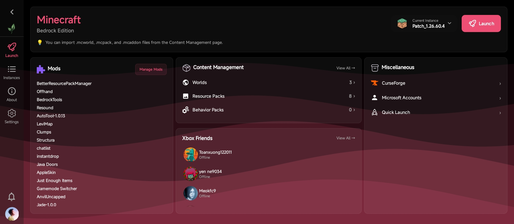

<div align="center">


# LeviLauncher for Android (Modder ver.)

🇺🇸 [English](README.md) | 🇻🇳 [Tiếng Việt (Vietnamese)](README_vi.md) | 🇯🇵 [日本語 (Japanese)](README_jp.md) | **🇷🇺 Русский (Russian)** | 🇨🇳 [中文 (Chinese)](README_zh.md)


**Лёгкий Android-лаунчер для Minecraft: Bedrock Edition**

[](https://github.com/sang765/LeviDroid-Modder/releases)
[](https://github.com/sang765/LeviDroid-Modder/blob/main/LICENSE)
[](https://github.com/sang765/LeviDroid-Modder/issues)
[](https://github.com/sang765/LeviDroid-Modder)
[](https://github.com/sang765/LeviDroid-Modder/releases)
[](https://www.android.com/)

<table>
  <tr>
    <td><a href="docs/screenshots/01-splash.jpg"></a></td>
    <td><a href="docs/screenshots/02-dashboard.jpg"></a></td>
  </tr>
  <tr>
    <td><a href="docs/screenshots/03-instances.jpg"></a></td>
    <td><a href="docs/screenshots/04-about.jpg"></a></td>
  </tr>
  <tr>
    <td><a href="docs/screenshots/05-settings.jpg"></a></td>
    <td><a href="docs/screenshots/06-mods.jpg"></a></td>
  </tr>
  <tr>
    <td><a href="docs/screenshots/07-world-editor.jpg"></a></td>
    <td><a href="docs/screenshots/08-launch.jpg"></a></td>
  </tr>
</table>

**[Документация](https://docs.levimc.org/LeviLauncher/guide/quick-start?platform=android)** · **[Разработка нативных модов](https://docs.levimc.org/LeviLamina/developer_guides/android/)**

</div>

---

## Введение

LeviLauncher Modder — это лёгкий open-source Android-лаунчер, созданный специально для легитимных игроков в Minecraft: Bedrock Edition (MCBE). Он предоставляет гибкую и удобную альтернативу стандартной установке из Google Play, позволяя управлять несколькими версиями игры и расширять функциональность с помощью внешних модулей.

LeviLauncher Modder — независимый форк оригинального проекта [LeviLauncher](https://github.com/LiteLDev/LeviLaunchroid) от [команды LeviMC](https://github.com/LiteLDev), который поддерживается [sang765](https://github.com/sang765) в этом репозитории.

LeviLauncher Modder позволяет импортировать ваш официальный Minecraft APK и запускать его напрямую без системной установки. Лаунчер поддерживает загрузку внешних нативных модулей для улучшения геймплея, обеспечивает надёжное управление несколькими версиями с полной изоляцией между установками и включает встроенные инструменты для управления ресурспаками и мирами. Независимо от того, хотите ли вы разобраться в разных версиях игры, тестировать модификации или оптимизировать игровой процесс, LeviLauncher Modder предлагает нужную вам гибкость.

---

## Основные возможности

### Оригинальное приложение

- **Импорт APK и запуск без установки** – Импортируйте свой официальный Minecraft APK и запускайте его напрямую без системной установки
- **Загрузка SO-модулей** – Загружайте внешние нативные SO-модули, чтобы расширить или улучшить функциональность и производительность Minecraft
- **Управление несколькими версиями и их изоляция** – Управляйте несколькими версиями Minecraft независимо, с раздельными конфигурациями и данными
- **Управление несколькими аккаунтами Xbox** – Управляйте несколькими аккаунтами Xbox внутри лаунчера и бесшовно переключайтесь между ними
- **Управление ресурспаками и мирами** – Импортируйте, экспортируйте и создавайте резервные копии ресурспаков и миров с помощью встроенного менеджера
- **Карта мира и расширенное редактирование NBT** – Просматривайте мир на живой карте и редактируйте его NBT-данные (настройки мира, чанки и записи базы данных) в редакторе мира с поэтапным сохранением и автоматическими резервными копиями — из обновления world tools апстрима

### Мой форк

**Почти** сохраняет оригинальный набор функций и добавляет изменения, сделанные для этого сообщества. По сравнению с [LiteLDev/LeviLaunchroid](https://github.com/LiteLDev/LeviLaunchroid):

- **Нет требования Google Play Store** – Оригинал блокирует запуск, если Minecraft не был установлен из Google Play. Этот форк требует только легитимной установки Minecraft Bedrock на устройстве, а импортированные инстансы (см. импорт APK выше) могут запускаться даже при полностью удалённом Minecraft, поскольку лаунчер запускает игру из собственной копии APK.
- **Поддержка пропатченного Minecraft (MCPatch)** – Патченные сборки содержат внедрённые нативные библиотеки, которые обычно резолвятся только внутри установленного патченного приложения. Лаунчер загружает эти библиотеки сам, поэтому патченный APK можно импортировать и запустить напрямую, не устанавливая патченное приложение на устройство.
- **Копируемые логи сбоев** – Диалог падения игры содержит кнопку, копирующую полный лог в буфер обмена, что упрощает отправку отчётов о проблемах.
- **CurseForge по желанию** – Просмотр CurseForge автоматически скрывается в сборках, скомпилированных без API-ключа CurseForge, вместо того чтобы всегда присутствовать и падать с ошибками при запросах.
- **Акцентный цвет из обоев** – В настройках цвета темы есть опция «Использовать цвет обоев», которая берёт акцентный цвет из ваших обоев. На Android 11 и ниже приложение запрашивает доступ к хранилищу, если обои не удалось прочитать.
- **Ребрендинг интерфейса и упоминания** – Приложение называется «LeviLauncher Modder», а на экране «О приложении» размещена карточка с благодарностью [sang765](https://github.com/sang765).
- **Альтернативные способы обновления** – В отличие от оригинальной версии, сборку Modder можно устанавливать также через Shizuku или root.
- **Каталог внешних модов** – Экран модов содержит ссылку на каталог модов сообщества с поиском, фильтрацией по совместимости с выбранной версией Minecraft и установкой в один тап.
- **Импорт и обновление модов с GitHub** – Диалог добавления мода импортирует файлы `.so`/`.levipack` из последнего релиза репозитория (принимает URL репозитория, `user/repo` или `user repo`), предупреждает, если мод предназначен для другой версии Minecraft, и запоминает источник, чтобы список модов мог отмечать более новые версии («Version 1.0 ⬆ 1.1») и устанавливать их в один тап.
- **Интеграция с друзьями Xbox** – Вкладка запуска показывает карточку друзей с аватарами, подсветкой онлайна и статусом присутствия. Полный экран друзей поддерживает поиск, добавление/удаление, входящие и исходящие запросы с возможностью отмены, ссылки на профили и автоматическое обновление при запуске, смене аккаунта и завершении действия.
- **Диалог «Что нового»** – После обновления лаунчер показывает диалог «Что нового» с примечаниями к релизу для этой версии.
- **Тёмная AMOLED-тема** – Режим темы предлагает варианты «Следовать системе», «Светлая» и чисто чёрный AMOLED-режим для OLED-экранов.
- **Метаданные контента в стиле Minecraft** – Цветовые коды разделов Minecraft (`§`) в названиях и описаниях паков и модов отображаются как настоящие цвета, а не как обычный текст.
- **Иконка приложения Material You** – Иконка лаунчера следует системному цвету тематических иконок на Android 12+.
- **Discord Rich Presence** – Необязательная интеграция с Discord (включается в настройках одним входом через OAuth2) показывает на вашем профиле Discord, чем вы занимаетесь: какая экран лаунчера открыта, просмотр CurseForge, друзья Xbox и активные сессии Minecraft.

---

## Системные требования

Перед установкой LeviLauncher Modder убедитесь, что ваше устройство соответствует следующим минимальным требованиям:

- **Операционная система:** Android 9.0 (API 28) или выше
- **Архитектура устройства:** ARM64 (v8a)
- **Оперативная память:** минимум 1 ГБ доступной ОЗУ (рекомендуется 2 ГБ и больше)
- **Хранилище:** не менее 2 ГБ свободного места для Minecraft и данных игры
- **Требование лицензии:** вы должны владеть лицензионной копией Minecraft Bedrock Edition, купленной в Google Play

> [!NOTE]
> Для оптимальной производительности и стабильности мы рекомендуем Android 9.0 или выше, минимум 3 ГБ доступной ОЗУ и 5 ГБ свободного места.

---

## Установка

### Предварительные требования

Прежде чем приступать к установке LeviLauncher Modder, убедитесь, что у вас есть собственная лицензионная копия Minecraft Bedrock Edition — либо уже установленная на устройстве (из любого легитимного источника), либо доступная в виде файла `.apk`/`.apks` для импорта в лаунчер.

### Шаги установки

1. Перейдите на [страницу релизов](https://github.com/sang765/LeviDroid-Modder/releases) и скачайте последний релиз. Каждый релиз содержит три APK: `-arm64-v8a` для большинства современных устройств, `-armeabi-v7a` для старых 32-битных устройств и `-universal`, который объединяет оба — если вы не уверены, какой выбрать
2. Откройте настройки устройства и перейдите в раздел «Безопасность» или «Приложения»
3. Включите «Неизвестные источники» или «Разрешить установку из неизвестных источников», чтобы разрешить установку APK
4. Найдите скачанный файл APK в файловом менеджере и нажмите на него для установки
5. Предоставьте необходимые разрешения, когда будет предложено во время установки
6. После установки откройте LeviLauncher Modder из ящика приложений

> [!IMPORTANT]
> LeviLauncher Modder, как и проект-апстрим LeviLauncher, требует легитимной лицензионной копии Minecraft Bedrock Edition. Не используйте этот лаунчер с пиратскими или неавторизованными версиями игры. Убедитесь, что ваша лицензия Minecraft действительна и правильно привязана к вашему аккаунту Microsoft.

---

## Настройка окружения разработки

Если вы хотите собрать LeviLauncher Modder из исходного кода или внести вклад в разработку, выполните следующие шаги для настройки окружения:

### Предварительные требования

- Установленный Git
- Android Studio (рекомендуется последняя версия)
- Java Development Kit (JDK) 21 или выше
- Android SDK с уровнем API 28 или выше
- Android NDK и CMake (установите их через SDK Manager в Android Studio) для сборки нативного кода

### Инструкция по настройке

1. Клонируйте репозиторий LeviLauncher Modder:

   ```bash
   git clone https://github.com/sang765/LeviDroid-Modder.git
   ```

2. Откройте каталог проекта в Android Studio

3. Разрешите Android Studio скачать и установить необходимые зависимости и инструменты сборки

4. Дождитесь завершения первоначальной синхронизации Gradle

5. Подключите устройство Android или запустите эмулятор (API 28+)

6. Нажмите кнопку «Run» в Android Studio, чтобы собрать и развернуть приложение на устройстве

7. Приложение запустится автоматически после успешного завершения сборки

> **Совет по сборке:** для ускорения сборки во время разработки используйте `Build > Make Project` для инкрементальной компиляции вместо полной пересборки.

Корневой проект называется `levilauncher` в настройках Gradle, тогда как репозиторий — `LeviDroid-Modder`. Для сборки из командной строки:

```bash
./gradlew assembleDebug
```

В Windows выполните `.\gradlew.bat assembleDebug`. Перед тестированием сценариев лаунчера установите легитимную копию официального приложения Minecraft на тестовое устройство.

---

## Переводы [](https://hosted.weblate.org/engage/levidroid-modder/)

[](https://hosted.weblate.org/engage/levidroid-modder/)

Помогите перевести LeviLauncher Modder на ваш язык на [Hosted Weblate](https://hosted.weblate.org/projects/levidroid-modder/). Английский — исходный язык; переводы ведутся отдельно для каждой локали (ресурсы `values-<lang>`) и поставляются со следующим релизом.

---

## Рекомендации для контрибьюторов

Мы приветствуем вклад сообщества в улучшение LeviLauncher Modder. Чтобы обеспечить качественную кодовую базу и плавное сотрудничество, придерживайтесь следующих рекомендаций:

### Качество кода

Пишите чистый, модульный код с понятными именами переменных и единообразным форматированием. Следуйте стилям Kotlin и Java, установленным в проекте. Обеспечивайте читаемость и хорошую структуру кода для будущих мейнтейнеров.

### Структура коммитов

Используйте небольшие, сфокусированные коммиты с понятными и содержательными сообщениями. Каждый коммит должен посвящаться одной функции или исправлению одного бага. Пример: «Fixed memory leak in version manager» или «Added support for ARM32 architecture».

### Документация

Добавляйте комментарии для сложной логики и обновляйте соответствующую документацию в репозитории. Если вы добавляете новые функции, обновите README и все связанные файлы документации.

### Производительность

Оптимизируйте все добавления, чтобы сохранять низкую задержку и плавную работу. Тщательно тестируйте свои изменения, чтобы они не добавляли лаги и регрессии производительности.

### Тестирование

Тестируйте все изменения на нескольких устройствах и версиях Android, чтобы обеспечить совместимость и стабильность.

### Pull Request'ы

Отправляйте PR с подробным описанием изменений, включая решённую проблему или добавленную функцию. Ссылайтесь на связанные issues и прикладывайте скриншоты или видео, если ваши изменения затрагивают интерфейс.

### Стандарты сообщества

Следуйте нашему кодексу поведения, чтобы поддерживать уважительную и инклюзивную среду. Будьте конструктивны в отзывах, уважайте чужой труд и общайтесь профессионально со всеми контрибьюторами.

**Перед отправкой:** выполните полный цикл сборки и протестируйте хотя бы на одном устройстве, чтобы минимизировать ошибки. Мы оперативно проверяем все вклады и ценим ваши усилия по улучшению LeviLauncher Modder.

---

## Рекомендации по использованию

LeviLauncher Modder предназначен для легитимных игроков в Minecraft Bedrock Edition. Пожалуйста, соблюдайте следующие рекомендации и условия использования:

### Разрешённое использование

- Модифицируйте LeviLauncher Modder для личной игры и тестирования новых функций
- Создавайте обучающий контент (видео, уроки, статьи в блоге), демонстрирующий возможности LeviLauncher Modder
- Делайте форк репозитория в учебных целях или для создания производных проектов при условии соблюдения лицензии Apache License 2.0
- Делитесь своими изменёнными версиями с другими, если соблюдаете условия Apache License 2.0

### Запрещённое использование

- Не выдавайте LeviLauncher Modder за своё, не упоминая оригинальный проект LeviLauncher и его авторов
- Не используйте LeviLauncher Modder для нарушения пользовательских соглашений Mojang или Microsoft

> **Отказ от ответственности:** Авторы и контрибьюторы LeviLauncher Modder не несут ответственности за блокировки, ущерб или проблемы, возникающие в результате использования этого программного обеспечения. Используйте его на свой риск и в соответствии с условиями обслуживания Minecraft.

Полные правовые детали см. в файлах LICENSE и NOTICE в репозитории.

---

## Благодарности и признательность

LeviLauncher Modder не был бы возможен без вклада и поддержки многих талантливых людей и организаций:

### Особая благодарность

- **[Организация LeviMC](https://github.com/LiteLDev)** – за создание и поддержку оригинального проекта [LeviLauncher](https://github.com/LiteLDev/LeviLaunchroid), на котором основан этот форк
- **Сообщество Android** – за отличную документацию, библиотеки и инструменты, благодаря которым этот лаунчер стал возможен
- **Open-source сообщество** – за все библиотеки, фреймворки и инструменты, на которых держится этот проект
- **Контрибьюторы** – от всего сердца благодарим всех [контрибьюторов оригинального проекта](https://github.com/LiteLDev/LeviLaunchroid/graphs/contributors), которые постоянно совершенствовали и поддерживали LeviLauncher, вкладывая своё время и экспертизу

---

## Контакты и поддержка

**Мейнтейнер:** [sang765](https://github.com/sang765)

**Репозиторий проекта:** [https://github.com/sang765/LeviDroid-Modder](https://github.com/sang765/LeviDroid-Modder)

**Оригинальный репозиторий:** [https://github.com/LiteLDev/LeviLaunchroid](https://github.com/LiteLDev/LeviLaunchroid)

**Документация:** [docs.levimc.org/LeviLauncher](https://docs.levimc.org/LeviLauncher/guide/quick-start?platform=android) · нативные моды: [docs.levimc.org/LeviLamina](https://docs.levimc.org/LeviLamina/developer_guides/android/)

**Сообщить о проблемах:** [Страница issues на GitHub](https://github.com/sang765/LeviDroid-Modder/issues)

**Поддержка и вопросы:** Пожалуйста, создайте issue в этом репозитории на GitHub

---

## История звёзд

<div align="center">
<a href="https://star-history.com/#sang765/LeviDroid-Modder&Date">
  <picture>
    <source media="(prefers-color-scheme: dark)" srcset="https://api.star-history.com/svg?repos=sang765/LeviDroid-Modder&type=Date&theme=dark" />
    <source media="(prefers-color-scheme: light)" srcset="https://api.star-history.com/svg?repos=sang765/LeviDroid-Modder&type=Date" />
    
  </picture>
</a>
</div>

---

## Контрибьюторы

<div align="center">
<a href="https://github.com/sang765/LeviDroid-Modder/graphs/contributors">
  
</a>
</div>

---

<div align="center">

[](https://github.com/sang765/LeviDroid-Modder/releases)
[](https://www.apache.org/licenses/LICENSE-2.0)
[](https://github.com/sang765/LeviDroid-Modder/issues)
[](https://github.com/sang765/LeviDroid-Modder)
[](https://github.com/sang765/LeviDroid-Modder/releases)
[](https://www.android.com/)

**Сделано с ❤️ [sang765](https://github.com/sang765)**

</div>
