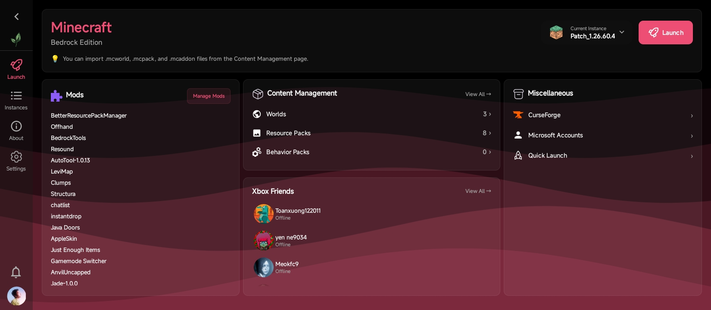

<div align="center">


# LeviLauncher for Android (Modder ver.)

🇺🇸 [English](README.md) | **🇻🇳 Tiếng Việt (Vietnamese)** | 🇯🇵 [日本語 (Japanese)](README_jp.md) | 🇷🇺 [Русский (Russian)](README_ru.md) | 🇨🇳 [中文 (Chinese)](README_zh.md)


**Launcher Android gọn nhẹ cho Minecraft: Bedrock Edition**

[](https://github.com/sang765/LeviDroid-Modder/releases)
[](https://github.com/sang765/LeviDroid-Modder/blob/main/LICENSE)
[](https://github.com/sang765/LeviDroid-Modder/issues)
[](https://github.com/sang765/LeviDroid-Modder)
[](https://github.com/sang765/LeviDroid-Modder/releases)
[](https://www.android.com/)

<table>
  <tr>
    <td><a href="docs/screenshots/01-splash.jpg"></a></td>
    <td><a href="docs/screenshots/02-dashboard.jpg"></a></td>
  </tr>
  <tr>
    <td><a href="docs/screenshots/03-instances.jpg"></a></td>
    <td><a href="docs/screenshots/04-about.jpg"></a></td>
  </tr>
  <tr>
    <td><a href="docs/screenshots/05-settings.jpg"></a></td>
    <td><a href="docs/screenshots/06-mods.jpg"></a></td>
  </tr>
  <tr>
    <td><a href="docs/screenshots/07-world-editor.jpg"></a></td>
    <td><a href="docs/screenshots/08-launch.jpg"></a></td>
  </tr>
</table>

https://github.com/user-attachments/assets/f69146c1-725c-46e7-9983-0768f6841910

**[Tài liệu](https://docs.levimc.org/LeviLauncher/guide/quick-start?platform=android)** · **[Phát triển mod native](https://docs.levimc.org/LeviLamina/developer_guides/android/)**

</div>

---

## Giới thiệu

LeviLauncher Modder là một launcher Android gọn nhẹ, mã nguồn mở, được thiết kế riêng cho người chơi chính chủ của Minecraft: Bedrock Edition (MCBE). Đây là một lựa chọn linh hoạt và thân thiện hơn so với cách cài đặt chuẩn qua Google Play, cho phép bạn quản lý nhiều phiên bản game và mở rộng tính năng bằng các module bên ngoài.

LeviLauncher Modder là một fork độc lập của [LeviLauncher](https://github.com/LiteLDev/LeviLaunchroid) gốc, do [nhóm LeviMC](https://github.com/LiteLDev) phát triển, được [sang765](https://github.com/sang765) duy trì trong kho lưu trữ này.

LeviLauncher Modder cho phép bạn nhập file APK Minecraft chính chủ của mình và chạy trực tiếp mà không cần cài đặt vào hệ thống. Launcher hỗ trợ nạp các module native SO bên ngoài để nâng cao gameplay, cung cấp hệ thống quản lý đa phiên bản vững chắc với sự cô lập hoàn toàn giữa các bản cài đặt, đồng thời tích hợp sẵn công cụ quản lý resource pack và thế giới. Dù bạn muốn sắp xếp các phiên bản game khác nhau, test các bản mod, hay tối ưu hóa trải nghiệm chơi, LeviLauncher Modder đều mang đến sự linh hoạt bạn cần.

---

## Tính năng chính

### Ứng dụng gốc

- **Nhập APK & khởi chạy không cần cài đặt** – Nhập file APK Minecraft chính chủ và chạy trực tiếp mà không cần cài đặt vào hệ thống
- **Nạp module SO** – Nạp các module SO native bên ngoài để mở rộng hoặc nâng cao tính năng và hiệu năng của Minecraft
- **Quản lý đa phiên bản & cô lập dữ liệu** – Quản lý nhiều phiên bản Minecraft độc lập, với cấu hình và dữ liệu tách biệt riêng từng phiên bản
- **Quản lý nhiều tài khoản Xbox** – Quản lý nhiều tài khoản Xbox ngay trong launcher và chuyển đổi giữa chúng mượt mà
- **Quản lý Resource Pack & thế giới** – Nhập, xuất và sao lưu resource pack cùng các thế giới của bạn bằng trình quản lý tích hợp sẵn
- **Bản đồ thế giới & chỉnh sửa NBT nâng cao** – Xem thế giới trên bản đồ trực tiếp và chỉnh sửa dữ liệu NBT (cài đặt thế giới, chunk và bản ghi cơ sở dữ liệu) trong trình chỉnh sửa thế giới, với lưu theo từng bước và tự động sao lưu — kế thừa từ bản cập nhật công cụ thế giới phía upstream

### Fork của tôi

**Gần như** giữ nguyên bộ tính năng gốc và bổ sung các thay đổi làm riêng cho cộng đồng này. So với [LiteLDev/LeviLaunchroid](https://github.com/LiteLDev/LeviLaunchroid):

- **Không bắt buộc Google Play Store** – Bản gốc chặn khởi chạy nếu Minecraft không được cài từ Google Play. Fork này chỉ yêu cầu một bản cài Minecraft Bedrock chính chủ trên thiết bị, và các phiên bản đã nhập (xem phần nhập APK ở trên) có thể khởi chạy kể cả khi Minecraft đã bị gỡ hoàn toàn, vì launcher chạy game từ bản sao APK riêng của nó.
- **Hỗ trợ Minecraft đã vá (MCPatch)** – Các bản build đã vá đi kèm thư viện native được tiêm vào, vốn chỉ resolve được bên trong app vá đã cài đặt. Launcher tự nạp các thư viện đó, nên một APK đã vá có thể được nhập và khởi chạy trực tiếp mà không cần cài app vá trên thiết bị.
- **Log crash có thể sao chép** – Hộp thoại crash game có nút sao chép toàn bộ log vào bộ nhớ tạm, giúp báo cáo vấn đề dễ dàng hơn.
- **CurseForge thành tùy chọn** – Phần duyệt CurseForge sẽ tự động bị ẩn trong các bản build biên dịch không có CurseForge API key, thay vì luôn hiển thị rồi báo lỗi khi request.
- **Màu nhấn theo wallpaper** – Cài đặt màu chủ đề có tùy chọn "Dùng màu wallpaper", tự chọn màu nhấn từ hình nền của bạn. Trên Android 11 trở xuống, tùy chọn này sẽ xin quyền truy cập Bộ nhớ khi không đọc được wallpaper.
- **Giao diện đổi thương hiệu & phần credits** – Ứng dụng mang tên "LeviLauncher Modder", với một thẻ giới thiệu dành cho [sang765](https://github.com/sang765) trên màn hình Giới thiệu.
- **Phương thức cập nhật thay thế** – Khác với bản gốc, bản Modder còn có thể được cập nhật qua Shizuku hoặc root.
- **Danh mục mod bên ngoài** – Màn hình Mods liên kết tới một danh mục mod cộng đồng có thể duyệt, với tìm kiếm, lọc tương thích theo phiên bản Minecraft đã chọn và cài đặt chỉ bằng một chạm.
- **Nhập mod từ GitHub & cập nhật** – Hộp thoại Thêm Mod nhập các file `.so`/`.levipack` từ release mới nhất của một repository (chấp nhận URL repository, `user/repo`, hoặc `user repo`), cảnh báo khi mod nhắm vào phiên bản Minecraft khác, và ghi nhớ nguồn để danh sách mod có thể đánh dấu các phiên bản mới hơn ("Version 1.0 ⬆ 1.1") và cài đặt chúng chỉ bằng một chạm.
- **Tích hợp Xbox Friends** – Thẻ tab Khởi chạy hiển thị một thẻ bạn bè với avatar, hiệu ứng sáng khi online và presence. Màn hình bạn bè đầy đủ hỗ trợ tìm kiếm, thêm/gỡ, lời mời vào và gửi đi kèm hủy lời mời, liên kết hồ sơ, và tự động làm mới khi khởi động, đổi tài khoản và sau khi hoàn tất thao tác.
- **Hộp thoại "Có gì mới"** – Sau khi cập nhật, launcher hiển thị hộp thoại "Có gì mới" kèm ghi chú phát hành được tạo cho phiên bản đó.
- **Chủ đề AMOLED nền đen** – Cài đặt chế độ chủ đề cung cấp Theo hệ thống, Sáng và chế độ AMOLED đen thuần cho màn hình OLED.
- **Metadata nội dung kiểu Minecraft** – Tên/mô tả của pack và mod hiển thị mã màu section-sign Minecraft (`§`) thành màu thật thay vì dạng văn bản thô.
- **Icon ứng dụng Material You** – Icon launcher theo màu themed-icon của hệ thống trên Android 12+.
- **Discord Rich Presence** – Tích hợp Discord tùy chọn (bật trong Cài đặt chỉ với một lần đăng nhập OAuth2) hiển thị bạn đang làm gì trên hồ sơ Discord: màn hình launcher bạn đang ở, duyệt CurseForge, Xbox friends, và các phiên Minecraft đang chạy.

---

## Yêu cầu hệ thống

Trước khi cài đặt LeviLauncher Modder, hãy đảm bảo thiết bị của bạn đáp ứng các thông số tối thiểu sau:

- **Hệ điều hành:** Android 9.0 (API 28) trở lên
- **Kiến trúc thiết bị:** ARM64 (v8a) hoặc ARM32 (v7a)
- **RAM:** Tối thiểu 1 GB RAM khả dụng (khuyến nghị 2 GB trở lên)
- **Lưu trữ:** Tối thiểu 2 GB dung lượng khả dụng cho Minecraft và dữ liệu game
- **Yêu cầu bản quyền:** Bạn phải sở hữu bản Minecraft Bedrock Edition có bản quyền đã mua từ Google Play

> [!NOTE]  
> Để có hiệu năng và độ ổn định tốt nhất, chúng tôi khuyến nghị Android 9.0 trở lên với ít nhất 3 GB RAM khả dụng và 5 GB dung lượng trống.

---

## Cài đặt

### Điều kiện tiên quyết

Trước khi tiến hành cài đặt LeviLauncher Modder, hãy đảm bảo bạn đã có bản Minecraft Bedrock Edition có bản quyền của riêng mình — dù đã cài sẵn trên thiết bị (từ bất kỳ nguồn chính chủ nào) hay ở dạng file `.apk`/`.apks` để nhập vào launcher.

### Các bước cài đặt

1. Truy cập [Trang Releases](https://github.com/sang765/LeviDroid-Modder/releases) và tải bản phát hành mới nhất. Mỗi bản phát hành gồm ba APK: `-arm64-v8a` cho hầu hết thiết bị hiện đại, `-armeabi-v7a` cho các thiết bị 32-bit cũ hơn, và `-universal` gộp cả hai nếu bạn không chắc nên chọn bản nào
2. Mở Cài đặt trên thiết bị và vào mục Bảo mật hoặc Ứng dụng
3. Bật "Nguồn không xác định" hoặc "Cho phép cài đặt từ nguồn không xác định" để cho phép cài APK
4. Dùng trình quản lý tệp tìm file APK vừa tải và chạm để cài đặt
5. Cấp các quyền cần thiết khi được yêu cầu trong quá trình cài đặt
6. Sau khi cài xong, mở LeviLauncher Modder từ ngăn kéo ứng dụng

> [!IMPORTANT]  
> LeviLauncher Modder — giống như dự án upstream LeviLauncher — yêu cầu một bản Minecraft Bedrock Edition chính chủ, có bản quyền. Đừng dùng launcher này với các phiên bản game lậu hoặc không được cấp phép. Hãy đảm bảo giấy phép Minecraft của bạn còn hiệu lực và đã liên kết đúng với tài khoản Microsoft.

---

## Thiết lập môi trường phát triển

Nếu bạn muốn build LeviLauncher Modder từ mã nguồn hoặc đóng góp cho dự án, hãy làm theo các bước sau để thiết lập môi trường phát triển:

### Điều kiện tiên quyết

- Git đã cài trên máy
- Android Studio (khuyến nghị bản mới nhất)
- Java Development Kit (JDK) 21 trở lên
- Android SDK với API level 28 trở lên
- Android NDK và CMake (cài qua SDK Manager trong Android Studio) khi build mã native

### Hướng dẫn thiết lập

1. Clone kho lưu trữ LeviLauncher Modder:

   ```bash
   git clone https://github.com/sang765/LeviDroid-Modder.git
   ```

2. Mở thư mục dự án trong Android Studio

3. Cho phép Android Studio tải xuống và cài đặt các dependency cùng công cụ build cần thiết

4. Đợi Gradle hoàn tất quá trình sync lần đầu

5. Kết nối thiết bị Android hoặc khởi động một emulator (API 28+)

6. Nhấn nút "Run" trong Android Studio để build và deploy lên thiết bị

7. Ứng dụng sẽ tự động khởi chạy sau khi build thành công

> **Mẹo build:** Để build nhanh hơn trong lúc phát triển, dùng `Build > Make Project` để biên dịch incremental thay vì build lại toàn bộ.

Tên project trong Gradle settings là `levilauncher`, còn kho lưu trữ là `LeviDroid-Modder`. Để build từ dòng lệnh:

```bash
./gradlew assembleDebug
```

Trên Windows, chạy `.\gradlew.bat assembleDebug`. Hãy cài một bản Minecraft chính chủ trên thiết bị test trước khi thử các luồng của launcher.

---

## Dịch thuật [](https://hosted.weblate.org/engage/levidroid-modder/)

[](https://hosted.weblate.org/engage/levidroid-modder/)

Hãy giúp dịch LeviLauncher Modder sang ngôn ngữ của bạn trên [Hosted Weblate](https://hosted.weblate.org/projects/levidroid-modder/). Tiếng Anh là ngôn ngữ gốc; các bản dịch được duy trì theo từng ngôn ngữ (resource `values-<lang>`) và phát hành cùng bản tiếp theo.

---

## Hướng dẫn đóng góp

Chúng tôi hoan nghênh sự đóng góp từ cộng đồng để cải thiện LeviLauncher Modder. Để đảm bảo codebase chất lượng cao và sự hợp tác trơn tru, xin hãy tuân thủ các hướng dẫn sau:

### Chất lượng code

Viết code sạch, modular với tên biến dễ hiểu và định dạng nhất quán. Theo dõi các style guideline Kotlin và Java đã được thiết lập trong dự án. Đảm bảo code của bạn dễ đọc và có cấu trúc tốt cho những người duy trì sau này.

### Cấu trúc commit

Dùng các commit nhỏ, tập trung với thông điệp rõ ràng, dễ hiểu. Mỗi commit nên giải quyết đúng một tính năng hoặc một bug fix. Ví dụ: "Fixed memory leak in version manager" hoặc "Added support for ARM32 architecture".

### Tài liệu

Thêm comment cho các logic phức tạp và cập nhật tài liệu liên quan trong kho lưu trữ. Nếu bạn thêm tính năng mới, hãy cập nhật README và các file tài liệu liên quan.

### Hiệu năng

Tối ưu mọi phần bổ sung để giữ độ trễ thấp và hiệu năng mượt mà. Test kỹ các thay đổi của bạn để đảm bảo chúng không gây lag hoặc làm giảm hiệu năng.

### Kiểm thử

Test mọi thay đổi trên nhiều thiết bị và nhiều phiên bản Android để đảm bảo tương thích và ổn định.

### Pull Request

Gửi PR kèm mô tả chi tiết về các thay đổi, nêu rõ vấn đề được giải quyết hoặc tính năng được thêm vào. Liên kết các issue liên quan và đính kèm ảnh chụp màn hình hoặc video nếu thay đổi của bạn ảnh hưởng đến giao diện.

### Tiêu chuẩn cộng đồng

Tuân thủ Bộ Quy tắc Ứng xử của chúng tôi để duy trì một môi trường tôn trọng và hòa nhập. Đóng góp ý kiến một cách xây dựng, tôn trọng công sức của người khác và giao tiếp chuyên nghiệp với tất cả các cộng tác viên.

**Trước khi gửi:** Chạy một chu trình build đầy đủ và test trên ít nhất một thiết bị để giảm thiểu lỗi. Chúng tôi xem xét mọi đóng góp nhanh chóng và trân trọng những nỗ lực của bạn nhằm nâng cao LeviLauncher Modder.

---

## Hướng dẫn sử dụng

LeviLauncher Modder được thiết kế cho những người chơi chính chủ của Minecraft Bedrock Edition. Xin hãy tôn trọng các hướng dẫn và điều khoản sử dụng sau:

### Các cách sử dụng được phép

- Sửa đổi LeviLauncher Modder cho mục đích chơi cá nhân và test tính năng mới
- Tạo nội dung giáo dục (video, tutorial, bài blog) giới thiệu các khả năng của LeviLauncher Modder
- Fork kho lưu trữ cho mục đích học hỏi hoặc tạo các dự án phái sinh, miễn là bạn tuân thủ Apache License 2.0
- Chia sẻ các phiên bản đã sửa đổi của bạn cho người khác, miễn là bạn tuân thủ các điều khoản Apache License 2.0

### Các cách sử dụng bị cấm

- Không được tự nhận LeviLauncher Modder là của mình mà không ghi công dự án LeviLauncher gốc cùng các tác giả của nó
- Không được dùng LeviLauncher Modder để vi phạm các thỏa thuận người dùng của Mojang hoặc Microsoft

> **Miễn trừ trách nhiệm:** Các tác giả và cộng tác viên của LeviLauncher Modder không chịu trách nhiệm cho các lệnh cấm, thiệt hại hoặc vấn đề phát sinh từ việc sử dụng phần mềm này. Hãy dùng nó dưới rủi ro của riêng bạn và theo đúng điều khoản dịch vụ của Minecraft.

Để xem chi tiết pháp lý đầy đủ, hãy tham khảo các tệp LICENSE và NOTICE trong kho lưu trữ.

---

## Ghi công & Lời cảm ơn

LeviLauncher Modder sẽ không thể thành hiện thực nếu không có sự đóng góp và hỗ trợ của nhiều cá nhân và tổ chức tài năng:

### Lời cảm ơn đặc biệt

- **[Tổ chức LeviMC](https://github.com/LiteLDev)** – Đã tạo ra và duy trì dự án [LeviLauncher](https://github.com/LiteLDev/LeviLaunchroid) gốc mà fork này dựa trên
- **Cộng đồng Android** – Với tài liệu, thư viện và công cụ tuyệt vời đã khiến launcher này thành hiện thực
- **Cộng đồng Mã nguồn mở** – Với tất cả các thư viện, framework và công cụ vận hành dự án này
- **Các cộng tác viên** – Một lời cảm ơn chân thành tới tất cả [các cộng tác viên của dự án gốc](https://github.com/LiteLDev/LeviLaunchroid/graphs/contributors) đã không ngừng cải thiện và duy trì LeviLauncher bằng thời gian cùng chuyên môn của họ

---

## Liên hệ & Hỗ trợ

**Người duy trì:** [sang765](https://github.com/sang765)

**Kho lưu trữ dự án:** [https://github.com/sang765/LeviDroid-Modder](https://github.com/sang765/LeviDroid-Modder)

**Kho lưu trữ gốc:** [https://github.com/LiteLDev/LeviLaunchroid](https://github.com/LiteLDev/LeviLaunchroid)

**Tài liệu:** [docs.levimc.org/LeviLauncher](https://docs.levimc.org/LeviLauncher/guide/quick-start?platform=android) · mod native: [docs.levimc.org/LeviLamina](https://docs.levimc.org/LeviLamina/developer_guides/android/)

**Báo lỗi:** [Trang GitHub Issues](https://github.com/sang765/LeviDroid-Modder/issues)

**Để được hỗ trợ và đặt câu hỏi:** Hãy tạo issue trên kho lưu trữ GitHub này

---

## Lịch sử Star

<div align="center">
<a href="https://star-history.com/#sang765/LeviDroid-Modder&Date">
  <picture>
    <source media="(prefers-color-scheme: dark)" srcset="https://api.star-history.com/svg?repos=sang765/LeviDroid-Modder&type=Date&theme=dark" />
    <source media="(prefers-color-scheme: light)" srcset="https://api.star-history.com/svg?repos=sang765/LeviDroid-Modder&type=Date" />
    
  </picture>
</a>
</div>

---

## Các cộng tác viên

<div align="center">
<a href="https://github.com/sang765/LeviDroid-Modder/graphs/contributors">
  
</a>
</div>

---

<div align="center">

[](https://github.com/sang765/LeviDroid-Modder/releases)
[](https://www.apache.org/licenses/LICENSE-2.0)
[](https://github.com/sang765/LeviDroid-Modder/issues)
[](https://github.com/sang765/LeviDroid-Modder)
[](https://github.com/sang765/LeviDroid-Modder/releases)
[](https://www.android.com/)

**Made with ❤️ by [sang765](https://github.com/sang765)**

</div>
