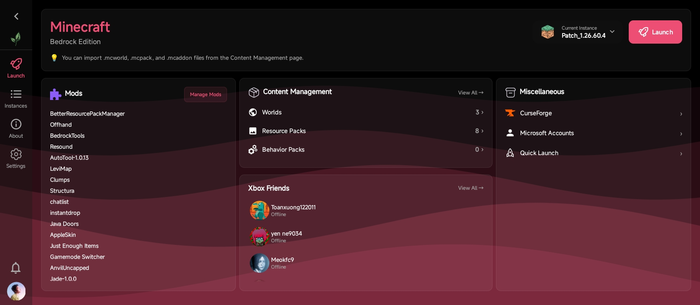

<div align="center">


# LeviLauncher for Android (Modder ver.)

🇺🇸 [English](README.md) | 🇻🇳 [Tiếng Việt (Vietnamese)](README_vi.md) | 🇯🇵 [日本語 (Japanese)](README_jp.md) | 🇷🇺 [Русский (Russian)](README_ru.md) | **🇨🇳 中文 (Chinese)**


**一款轻量级的 Minecraft: Bedrock Edition 安卓启动器**

[](https://github.com/sang765/LeviDroid-Modder/releases)
[](https://github.com/sang765/LeviDroid-Modder/blob/main/LICENSE)
[](https://github.com/sang765/LeviDroid-Modder/issues)
[](https://github.com/sang765/LeviDroid-Modder)
[](https://github.com/sang765/LeviDroid-Modder/releases)
[](https://www.android.com/)

<table>
  <tr>
    <td><a href="docs/screenshots/01-splash.jpg"></a></td>
    <td><a href="docs/screenshots/02-dashboard.jpg"></a></td>
  </tr>
  <tr>
    <td><a href="docs/screenshots/03-instances.jpg"></a></td>
    <td><a href="docs/screenshots/04-about.jpg"></a></td>
  </tr>
  <tr>
    <td><a href="docs/screenshots/05-settings.jpg"></a></td>
    <td><a href="docs/screenshots/06-mods.jpg"></a></td>
  </tr>
  <tr>
    <td><a href="docs/screenshots/07-world-editor.jpg"></a></td>
    <td><a href="docs/screenshots/08-launch.jpg"></a></td>
  </tr>
</table>

**[文档](https://docs.levimc.org/LeviLauncher/guide/quick-start?platform=android)** · **[原生模组开发](https://docs.levimc.org/LeviLamina/developer_guides/android/)**

</div>

---

## 简介

LeviLauncher Modder 是一款轻量级的开源安卓启动器，专为 Minecraft: Bedrock Edition（MCBE）的正版玩家设计。它为标准的 Google Play 安装方式提供了灵活、易用的替代方案，让你能够管理多个游戏版本，并通过外部模块扩展功能。

LeviLauncher Modder 是 [LeviMC 团队](https://github.com/LiteLDev) 原版 [LeviLauncher](https://github.com/LiteLDev/LeviLaunchroid) 的独立分支，由 [sang765](https://github.com/sang765) 在本仓库中维护。

LeviLauncher Modder 让你能够导入官方 Minecraft APK 并直接运行，无需系统安装。启动器支持加载外部原生模块以增强游戏体验，提供强大的多版本管理能力且各安装之间完全隔离，并内置了管理资源包和世界的工具。无论你是想整理不同的游戏版本、测试修改内容，还是优化游戏体验，LeviLauncher Modder 都能提供你所需的灵活性。

---

## 主要特性

### 原版功能

- **APK 导入与免安装启动** – 导入你的官方 Minecraft APK 并直接运行，无需系统安装
- **SO 模块加载** – 加载外部原生 SO 模块，扩展或增强 Minecraft 的功能与性能
- **多版本管理与版本隔离** – 独立管理多个 Minecraft 版本，配置与数据相互隔离
- **多 Xbox 账号管理** – 在启动器内管理多个 Xbox 账号，并可无缝切换
- **资源包与世界管理** – 使用内置管理器导入、导出并备份你的资源包和世界
- **世界地图与高级 NBT 编辑** – 在实时地图上查看世界，并在世界编辑器中编辑其 NBT 数据（世界设置、区块和数据库记录），支持分阶段保存与自动备份 —— 来自上游世界工具的更新

### 本分支

**几乎**保留了原版的全部功能，并为本社区增加了新的改动。与 [LiteLDev/LeviLaunchroid](https://github.com/LiteLDev/LeviLaunchroid) 相比：

- **不再要求 Google Play 商店** – 原版只有通过 Google Play 安装 Minecraft 才允许启动。本分支只要求设备上存在正版的 Minecraft Bedrock 安装，而且导入的实例（见上文 APK 导入）即使在 Minecraft 被完全卸载的情况下也能启动，因为启动器是通过自己的 APK 副本来运行游戏的。
- **支持打补丁的 Minecraft（MCPatch）** – 打过补丁的构建会携带注入的原生库，这些库通常只能在已安装的补丁应用内解析。启动器会自行加载这些库，因此补丁 APK 可以直接导入并启动，无需在设备上安装补丁应用。
- **可复制的崩溃日志** – 游戏崩溃对话框中有一个按钮，可将完整日志复制到剪贴板，方便反馈问题。
- **CurseForge 变为可选** – 在没有编译 CurseForge API 密钥的构建中，CurseForge 浏览功能会自动隐藏，而不是始终存在并在请求时失败。
- **壁纸强调色** – 主题色设置中新增“使用壁纸颜色”选项，可从你的壁纸中提取强调色。在 Android 11 及更低版本上，当无法读取壁纸时会请求存储访问权限。
- **重新品牌化的 UI 与致谢** – 应用名为“LeviLauncher Modder”，关于页面上有 [sang765](https://github.com/sang765) 的致谢卡片。
- **替代的更新方式** – 与原版不同，Modder 构建还可以通过 Shizuku 或 root 安装。
- **外部模组目录** – 模组页面链接到一个可浏览的社区模组目录，支持搜索、按所选 Minecraft 版本过滤兼容性，以及一键安装。
- **GitHub 模组导入与更新** – 添加模组对话框可从仓库的最新 release 导入 `.so`/`.levipack` 文件（接受仓库 URL、`user/repo` 或 `user repo` 格式），当模组面向不同 Minecraft 版本时会发出警告，并记住来源，从而让模组列表可以标记更新的版本（“Version 1.0 ⬆ 1.1”）并一键安装。
- **Xbox 好友集成** – 启动标签页显示好友卡片，包含头像、在线光效和在线状态。完整的好友页面支持搜索、添加/删除、可取消的收发请求、资料链接，以及在启动、切换账号和操作完成后自动刷新。
- **更新日志对话框** – 更新后，启动器会显示“新功能”对话框，其中包含为该版本生成的发行说明。
- **深色 AMOLED 主题** – 主题模式设置提供跟随系统、浅色，以及面向 OLED 屏幕的纯黑 AMOLED 模式。
- **Minecraft 风格的内容元数据** – 包和模组的名称/描述会将 Minecraft 的章节符号颜色代码（`§`）渲染为真实颜色，而不是显示原始文本。
- **Material You 应用图标** – 启动器图标在 Android 12+ 上跟随系统主题图标的颜色。
- **Discord Rich Presence** – 可选的 Discord 集成（在设置中通过一次 OAuth2 登录即可启用），会在你的 Discord 资料上显示你正在做的事：当前所在的启动器页面、CurseForge 浏览、Xbox 好友，以及正在运行的 Minecraft 会话。

---

## 系统要求

在安装 LeviLauncher Modder 之前，请确保你的设备满足以下最低规格：

- **操作系统：** Android 9.0（API 28）或更高版本
- **设备架构：** ARM64（v8a）
- **内存：** 至少 1 GB 可用内存（推荐 2 GB 或以上）
- **存储：** 至少 2 GB 可用存储空间，用于 Minecraft 和游戏数据
- **授权要求：** 你必须拥有从 Google Play 购买的正版 Minecraft Bedrock Edition

> [!NOTE]
> 为了获得最佳性能和稳定性，我们推荐 Android 9.0 或更高版本，至少 3 GB 可用内存和 5 GB 剩余存储空间。

---

## 安装

### 前置条件

在继续安装 LeviLauncher Modder 之前，请确保你拥有自己的正版 Minecraft Bedrock Edition —— 要么已安装在设备上（来自任何合法来源），要么以 `.apk`/`.apks` 文件的形式可供导入启动器。

### 安装步骤

1. 访问 [发布页面](https://github.com/sang765/LeviDroid-Modder/releases) 并下载最新版本。每个版本发布三个 APK：适用于大多数现代设备的 `-arm64-v8a`、适用于较旧 32 位设备的 `-armeabi-v7a`，以及在你不确定时可同时包含两者的 `-universal`
2. 打开设备的“设置”，进入“安全”或“应用”选项
3. 启用“未知来源”或“允许安装未知来源的应用”，以允许安装 APK
4. 使用文件管理器找到下载的 APK 文件，点击安装
5. 安装过程中按提示授予必要的权限
6. 安装完成后，从应用抽屉中打开 LeviLauncher Modder

> [!IMPORTANT]
> LeviLauncher Modder —— 与上游 LeviLauncher 项目一样 —— 需要一份正版、有授权的 Minecraft Bedrock Edition。请勿将本启动器用于盗版或未授权的游戏版本。请确保你的 Minecraft 授权有效并已正确关联到你的 Microsoft 账号。

---

## 开发环境配置

如果你想从源码构建 LeviLauncher Modder 或参与开发，请按照以下步骤配置你的开发环境：

### 前置条件

- 系统已安装 Git
- Android Studio（推荐最新版本）
- Java 开发工具包（JDK）21 或更高版本
- API 级别 28 或更高的 Android SDK
- 构建原生代码时需要 Android NDK 和 CMake（通过 Android Studio 的 SDK Manager 安装）

### 配置说明

1. 克隆 LeviLauncher Modder 仓库：

   ```bash
   git clone https://github.com/sang765/LeviDroid-Modder.git
   ```

2. 在 Android Studio 中打开项目目录

3. 允许 Android Studio 下载并安装所需的依赖和构建工具

4. 等待 Gradle 完成初始同步过程

5. 连接你的 Android 设备或启动模拟器（API 28+）

6. 点击 Android Studio 中的“Run”按钮，构建并部署到你的设备

7. 构建成功完成后应用会自动启动

> **构建提示：** 为了在开发期间加快构建速度，请使用 `Build > Make Project` 进行增量编译，而不是完整重新构建。

项目根目录在 Gradle 设置中名为 `levilauncher`，而仓库名为 `LeviDroid-Modder`。从命令行构建：

```bash
./gradlew assembleDebug
```

在 Windows 上，运行 `.\gradlew.bat assembleDebug`。测试前请在测试设备上安装一份正版的官方 Minecraft 应用。

---

## 翻译 [](https://hosted.weblate.org/engage/levidroid-modder/)

[](https://hosted.weblate.org/engage/levidroid-modder/)

欢迎在 [Hosted Weblate](https://hosted.weblate.org/projects/levidroid-modder/) 上帮助把 LeviLauncher Modder 翻译成你的语言。英语是源语言；翻译按语言环境维护（`values-<lang>` 资源），并随下一个版本发布。

---

## 贡献指南

我们欢迎社区为改进 LeviLauncher Modder 做出贡献。为保证高质量的代码库和顺畅的协作，请遵循以下准则：

### 代码质量

编写整洁、模块化的代码，使用描述性的变量名并保持格式一致。遵循项目中确立的 Kotlin 和 Java 代码风格指南。确保你的代码易于阅读、结构清晰，方便后续维护。

### 提交结构

使用小而聚焦的提交，并附上清晰、描述性的提交信息。每个提交应只处理一个功能或一个缺陷修复。例如：“Fixed memory leak in version manager” 或 “Added support for ARM32 architecture”。

### 文档

为复杂逻辑添加注释，并更新仓库中的相关文档。如果你添加了新功能，请更新 README 及任何相关的文档文件。

### 性能

优化所有新增内容，以保持低延迟和流畅的性能。彻底测试你的更改，确保不会引入卡顿或性能回退。

### 测试

在多种设备和 Android 版本上测试所有更改，以确保兼容性和稳定性。

### Pull Request

提交 PR 时请附上详细的更改说明，包括所解决的问题或新增的功能。引用相关 issue，如果你的更改影响 UI，请提供截图或视频。

### 社区规范

遵循我们的行为准则，维护一个尊重和包容的环境。反馈要有建设性，尊重他人的工作，并以专业的态度与所有贡献者沟通。

**提交前：** 完整运行一次构建周期，并至少在一台设备上测试，以尽量减少错误。我们会及时审查所有贡献，感谢你为增强 LeviLauncher Modder 所付出的努力。

---

## 使用准则

LeviLauncher Modder 专为 Minecraft Bedrock Edition 的正版玩家设计。请遵守以下准则和使用条款：

### 允许的用途

- 为个人游戏和测试新功能而修改 LeviLauncher Modder
- 制作展示 LeviLauncher Modder 功能的教育内容（视频、教程、博文）
- 为学习目的或创建衍生项目而 Fork 本仓库，前提是遵守 Apache License 2.0
- 只要遵守 Apache License 2.0 条款，就可以与他人分享你修改过的版本

### 禁止的用途

- 不得在未注明原版 LeviLauncher 项目及其作者的情况下，将 LeviLauncher Modder 声称为你自己的作品
- 不得使用 LeviLauncher Modder 违反 Mojang 或 Microsoft 的用户协议

> **免责声明：** LeviLauncher Modder 的作者和贡献者对因使用本软件而导致的封禁、损失或问题概不负责。请自行承担风险，并遵守 Minecraft 的服务条款使用本软件。

有关完整的法律细节，请参阅仓库中的 LICENSE 和 NOTICE 文件。

---

## 致谢

没有许多才华横溢的个人和组织的贡献与支持，LeviLauncher Modder 就不可能诞生：

### 特别感谢

- **[LeviMC 组织](https://github.com/LiteLDev)** – 创建并维护了本分支所基于的原版 [LeviLauncher](https://github.com/LiteLDev/LeviLaunchroid) 项目
- **Android 社区** – 提供了出色的文档、库和工具，使本启动器成为可能
- **开源社区** – 提供了驱动本项目的所有库、框架和工具
- **贡献者** – 衷心感谢[原版项目的所有贡献者](https://github.com/LiteLDev/LeviLaunchroid/graphs/contributors)，他们用自己的时间和专业知识不断改进和维护 LeviLauncher

---

## 联系与支持

**维护者：** [sang765](https://github.com/sang765)

**项目仓库：** [https://github.com/sang765/LeviDroid-Modder](https://github.com/sang765/LeviDroid-Modder)

**原版仓库：** [https://github.com/LiteLDev/LeviLaunchroid](https://github.com/LiteLDev/LeviLaunchroid)

**文档：** [docs.levimc.org/LeviLauncher](https://docs.levimc.org/LeviLauncher/guide/quick-start?platform=android) · 原生模组：[docs.levimc.org/LeviLamina](https://docs.levimc.org/LeviLamina/developer_guides/android/)

**反馈问题：** [GitHub Issues 页面](https://github.com/sang765/LeviDroid-Modder/issues)

**寻求支持与提问：** 请在本 GitHub 仓库上创建 issue

---

## Star 历史

<div align="center">
<a href="https://star-history.com/#sang765/LeviDroid-Modder&Date">
  <picture>
    <source media="(prefers-color-scheme: dark)" srcset="https://api.star-history.com/svg?repos=sang765/LeviDroid-Modder&type=Date&theme=dark" />
    <source media="(prefers-color-scheme: light)" srcset="https://api.star-history.com/svg?repos=sang765/LeviDroid-Modder&type=Date" />
    
  </picture>
</a>
</div>

---

## 贡献者

<div align="center">
<a href="https://github.com/sang765/LeviDroid-Modder/graphs/contributors">
  
</a>
</div>

---

<div align="center">

[](https://github.com/sang765/LeviDroid-Modder/releases)
[](https://www.apache.org/licenses/LICENSE-2.0)
[](https://github.com/sang765/LeviDroid-Modder/issues)
[](https://github.com/sang765/LeviDroid-Modder)
[](https://github.com/sang765/LeviDroid-Modder/releases)
[](https://www.android.com/)

**由 [sang765](https://github.com/sang765) 用心打造 ❤️**

</div>
